# RivetMSP for Android: user guide

A quick tour of the technician app. Screenshots are from a demo server with fictional data (light theme; every screen also has a dark version in `docs/screenshots/dark/`).

## 1. Connect to your server

<table>
<tr>
<td width="33%">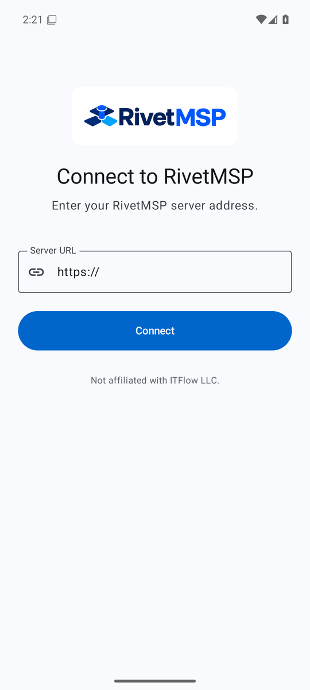</td>
<td width="33%">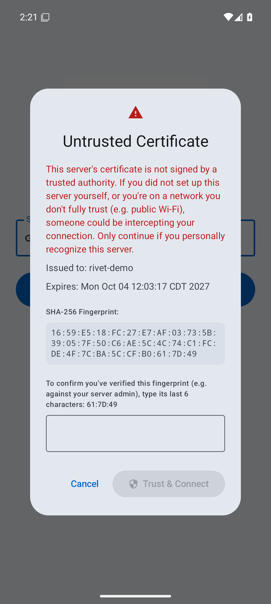</td>
<td width="33%">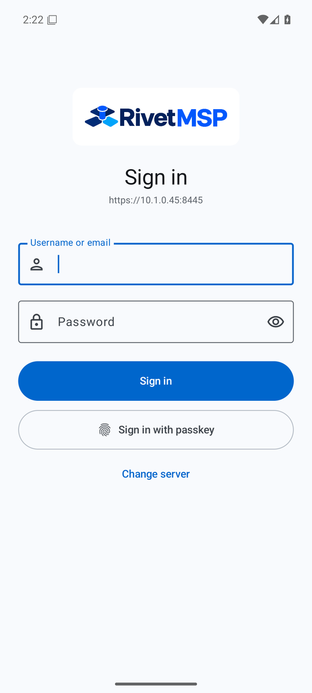</td>
</tr>
</table>

1. Open the app and enter your RivetMSP address, for example `https://psa.example.com`. Only `https://` addresses are accepted.
2. If the server uses a self-signed certificate, the app shows its fingerprint. Verify it with your server admin, type the last 6 characters to confirm, then tap **Trust & Connect**. Servers with a normal certificate skip this step.
3. Sign in with your technician username (or email) and password. If two-factor authentication is on, you are asked for your code. Use **Sign in with passkey** if you have registered one.

Use **Change server** on the sign-in screen to point the app at a different server.

## 2. Home

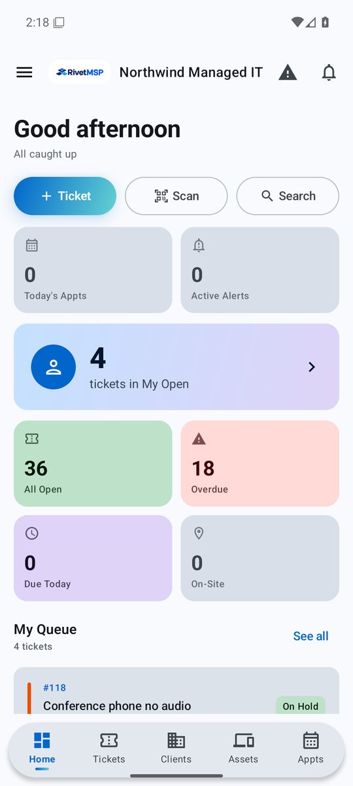

Home is your daily dashboard.

- **+ Ticket**, **Scan** (barcode or QR asset lookup) and **Search** are one tap away.
- The tiles show today's appointments, active alerts, your open tickets, all open tickets, overdue, due today and on-site counts. Tap a tile to jump to the matching list.
- **My Queue** lists the tickets assigned to you; **See all** opens them in Tickets.

The top bar shows your company name and logo, with **Alerts** (warning triangle) and **Notifications** (bell) on the right. A red dot on the bell means something is unread. The **menu** button on the left opens the side menu.

 

## 3. Tickets

<table>
<tr>
<td width="33%">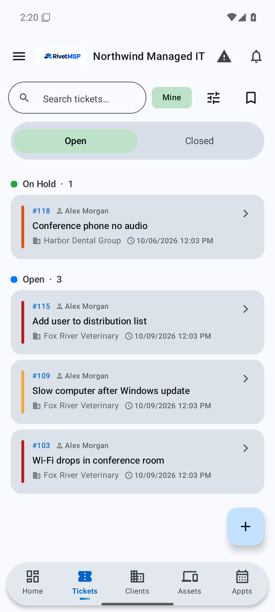</td>
<td width="33%">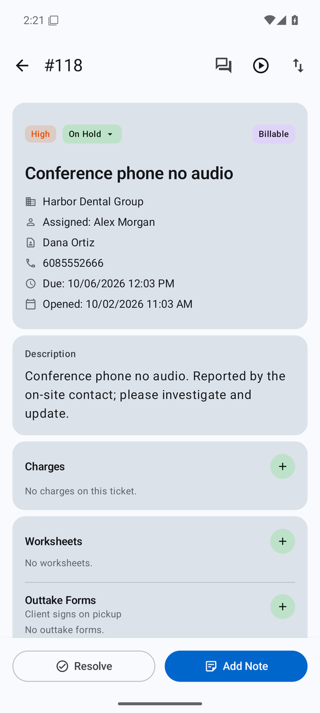</td>
<td width="33%">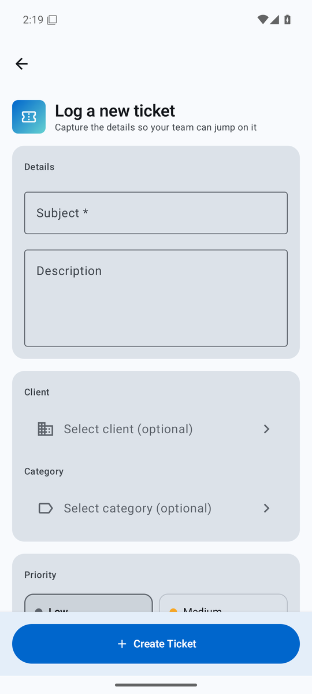</td>
</tr>
</table>

- **List.** Switch between **Open** and **Closed**, search by subject, tap **Mine** to see only your tickets, use the filter button for more filters and the bookmark button for saved views. Tickets are grouped by status, and the coloured bar on the left shows priority.
- **Detail.** Shows status, priority, client, contact, assignee, due date and description, plus Charges, Worksheets and Outtake Forms. Change the status from the status chip. Use **Add Note** to reply to the client or add an internal note, and **Resolve** to close the ticket.
- **New ticket.** Tap the **+** button (or **+ Ticket** on Home). A subject is required. Client and category are optional. Pick the priority, then **Create Ticket**.

## 4. Clients

<table>
<tr>
<td width="33%">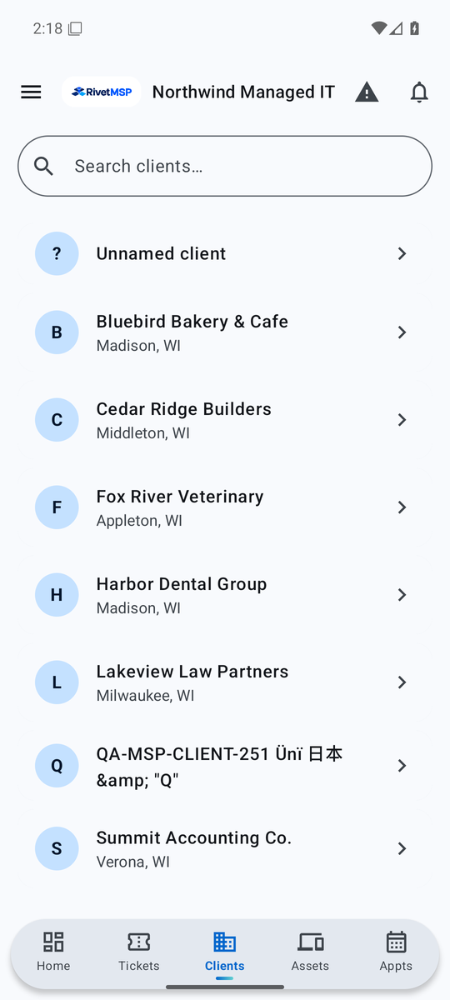</td>
<td width="33%">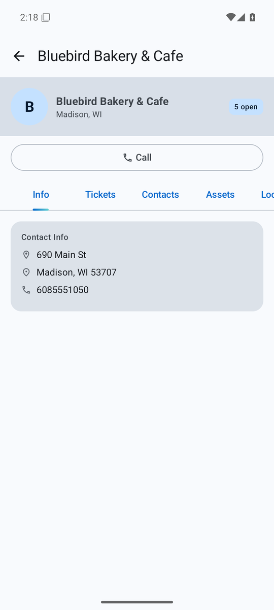</td>
</tr>
</table>

Search the list, or tap a client to see contact info, with a **Call** shortcut. The tabs along the top show that client's tickets, contacts, assets, and more.

## 5. Assets

<table>
<tr>
<td width="33%">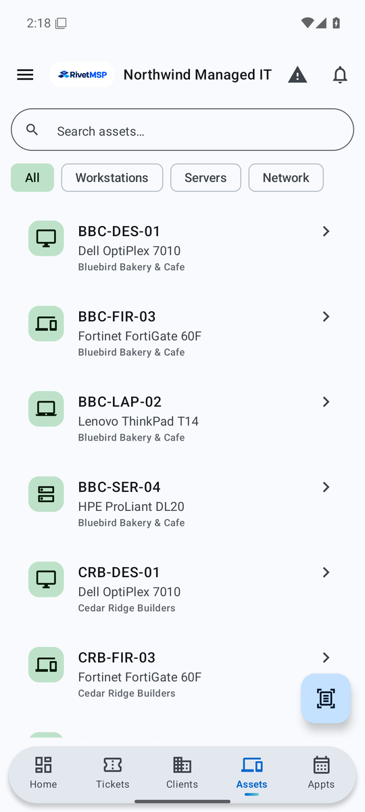</td>
<td width="33%">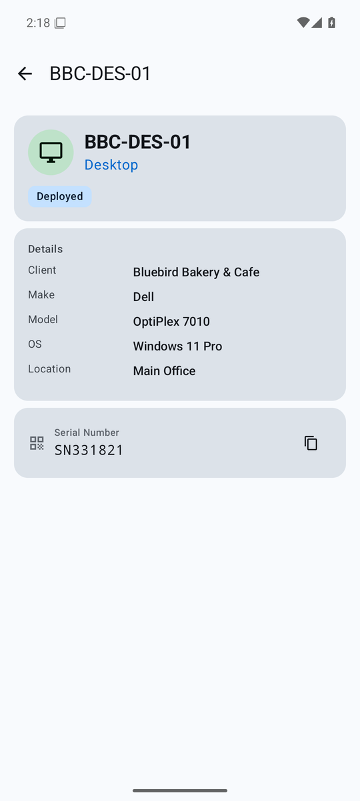</td>
</tr>
</table>

Filter by **All**, **Workstations**, **Servers** or **Network**, or search by name. Each row shows the asset, its make and model, and the client it belongs to. The detail screen shows status, details such as OS and location, and the serial number (tap the copy icon to copy it). The scan button at the bottom right looks an asset up from its barcode or QR label.

## 6. Appointments

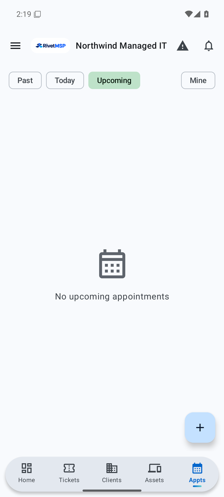

Switch between **Past**, **Today** and **Upcoming**, and use **Mine** to limit the list to your own. Tap **+** to schedule an appointment.

 

## 7. Side menu

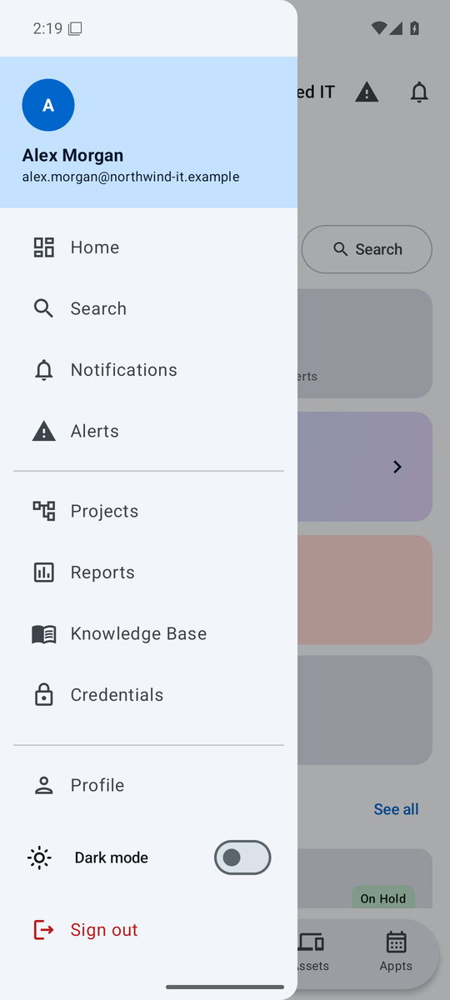

Open it with the menu button. It holds Home, Search, Notifications, Alerts, Projects, Reports, Knowledge Base and Credentials, then Profile, the **Dark mode** switch and **Sign out**. Items you do not have permission to use are hidden, and billing screens only appear when your server has those modules switched on.

 

## Tips

- The app locks when it is reopened if you enable app lock in **Profile**.
- Screen capture is blocked in normal builds to protect client data. Documentation screenshots come from a QA build only.
