# RivetIT Mobile (Android) — Technician Guide

Screenshots were captured from build 1.30.1-beta against the RivetIT demo server (fictional data).
Some screens depend on which modules your server has enabled.

## 1. Connect to your server

Enter your RivetIT server address (for example `https://rivetit.example.com`) and tap **Connect**.

If the server uses a self-signed certificate, the app shows an **Untrusted Certificate** warning with the
certificate's SHA-256 fingerprint. Compare it with the fingerprint your server admin gives you, then
type the **last 6 characters** shown (colons are optional) to enable **Trust & Connect**. Never trust a
certificate you can't verify.

Then sign in with your username/email and password, or **Sign in with passkey**.

## 2. Home

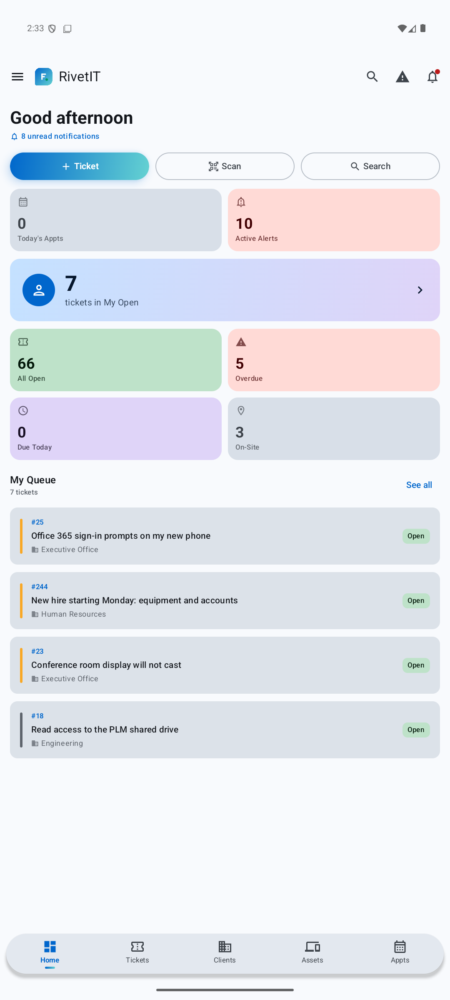

- **Ticket / Scan / Search** quick actions at the top.
- Tiles: today's appointments, active alerts, your open tickets, all open, overdue, due today, on-site.
- **My Queue** lists your tickets; tap one to open it, or **See all**.
- Bottom bar: **Home, Tickets, Clients, Assets, Appts**. The ☰ menu opens everything else.

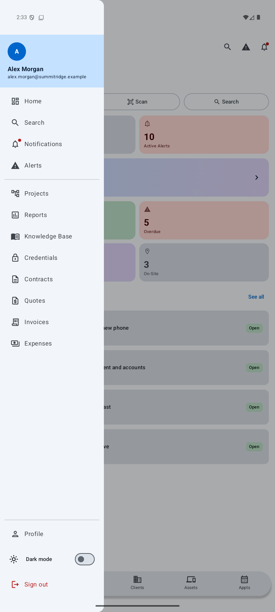

The menu holds Search, Notifications, Alerts, Projects, Reports, Knowledge Base, Credentials, Contracts,
Quotes, Invoices, Expenses, Profile, the **Dark mode** switch and Sign out.

## 3. Tickets

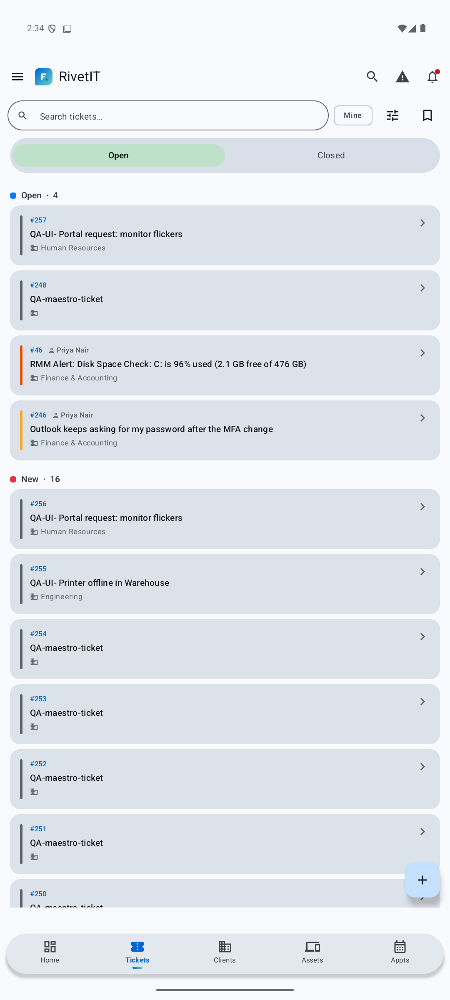

- Search, a **Mine** filter and two icon buttons (filters, saved views) across the top; **Open / Closed** tabs below.
- Tickets are grouped by status; the colored bar on each card is its priority.
- **+** creates a ticket.

### Open a ticket

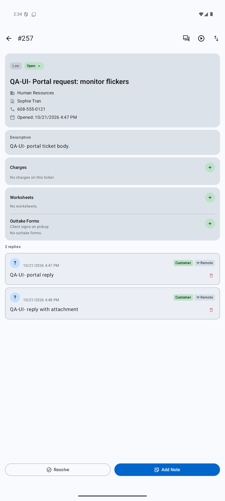

Shows status, priority, client, contact, description, charges, worksheets, outtake forms and the reply
thread. **Add Note** posts a reply, **Resolve** closes the ticket. The icons at the top right include the live
chat view (the other two were not exercised for this guide).

### Create a ticket

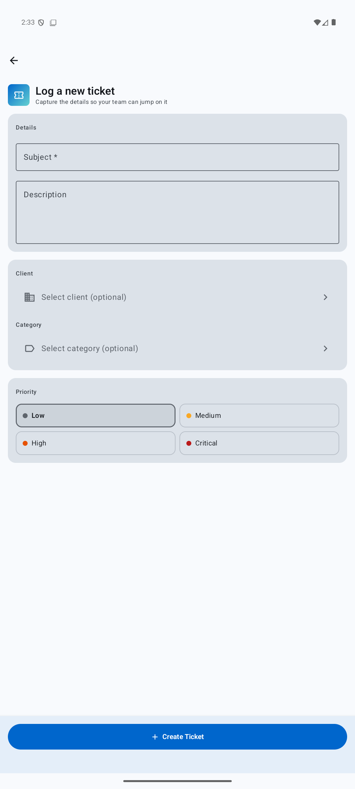

Subject is required. Optionally pick a client and category, choose a priority, then **Create Ticket**.

## 4. Clients, Assets, Appointments

| Clients | Client detail | Assets |
|---|---|---|
| 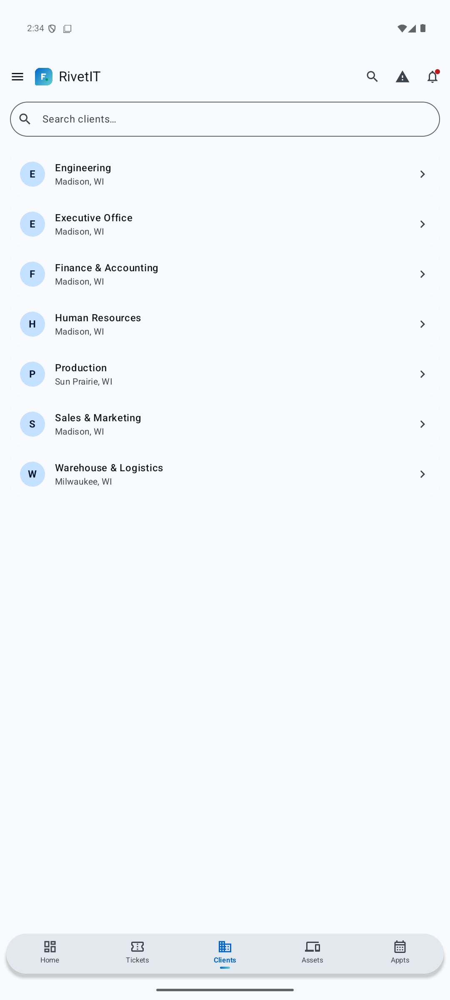 | 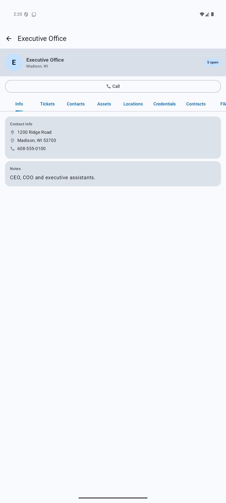 | 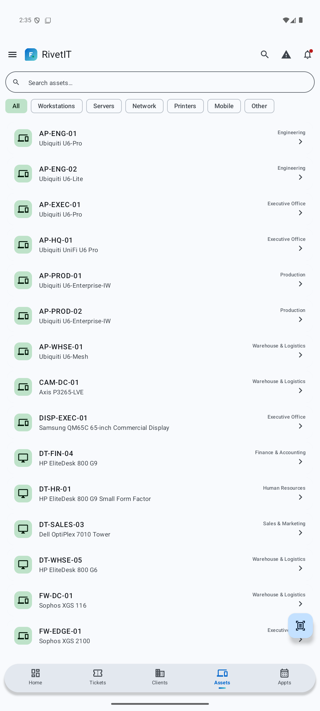 |

- A client opens to **Info, Tickets, Contacts, Assets, Locations, Credentials, Contracts, Files…** tabs, with a
  one-tap **Call** button.
- **Assets** can be filtered by type, and the scan button reads barcodes/QR codes to jump straight to an asset.

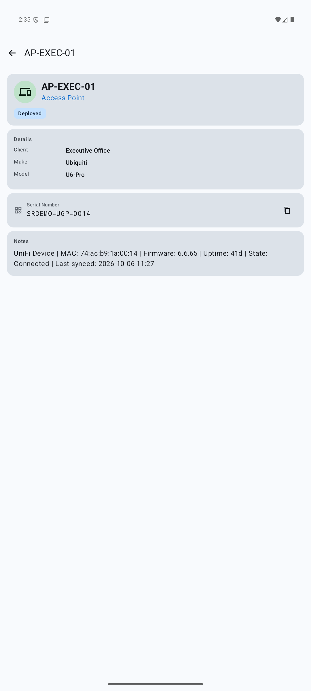

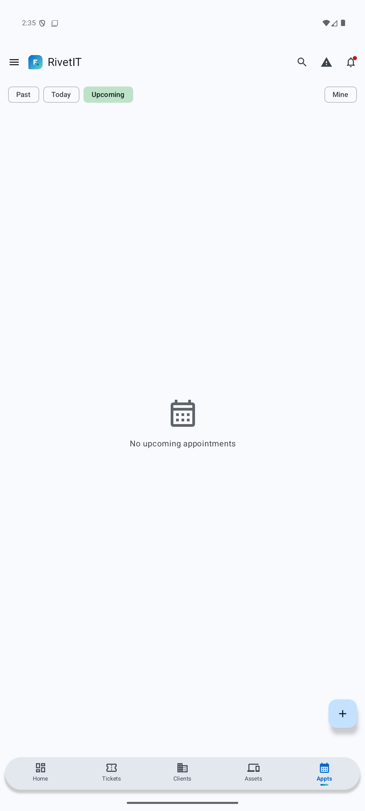

**Appts** shows Past / Today / Upcoming appointments.

## 5. Alerts and notifications

| Notifications | Alerts |
|---|---|
| 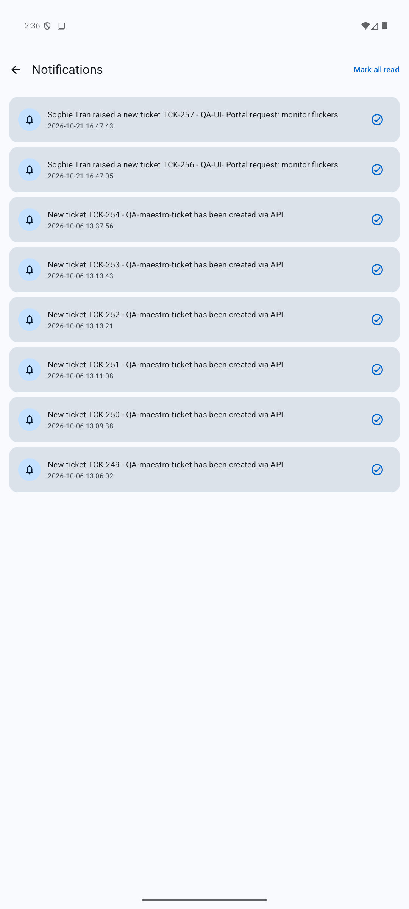 | 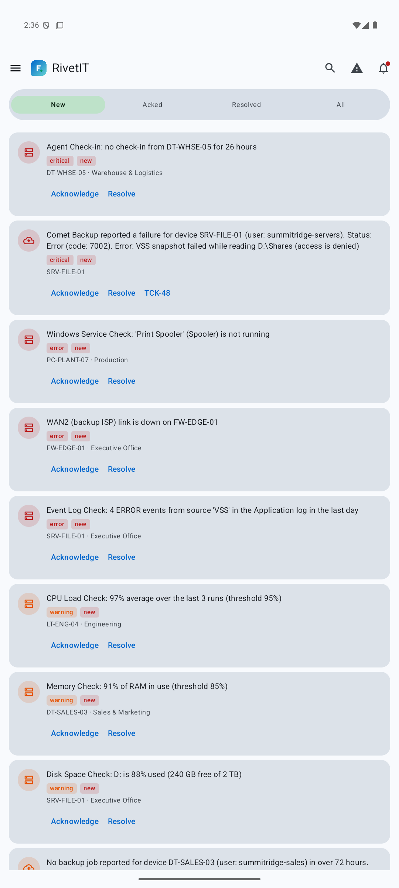 |

Alerts are grouped **New / Acked / Resolved / All**. Use **Acknowledge** and **Resolve** directly on a card.
Alerts that already have a ticket show its number (e.g. `TCK-48`) on the card.

## 6. Projects, Contracts, Knowledge Base, Reports

| Projects | Contracts | Knowledge Base | Reports |
|---|---|---|---|
| 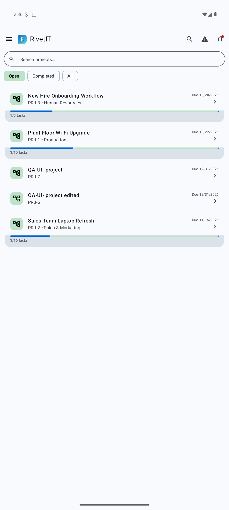 | 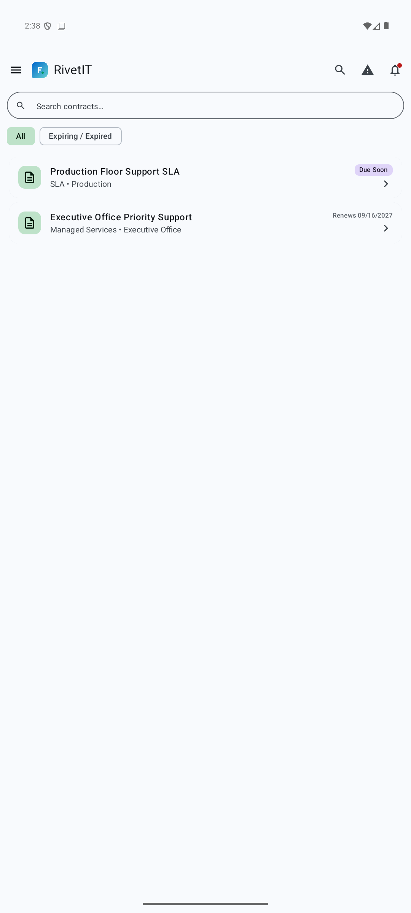 | 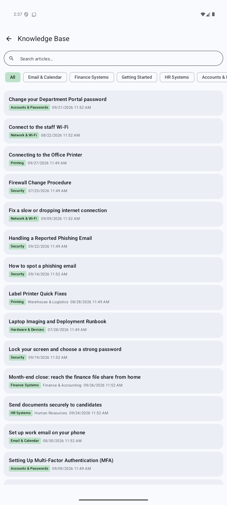 | 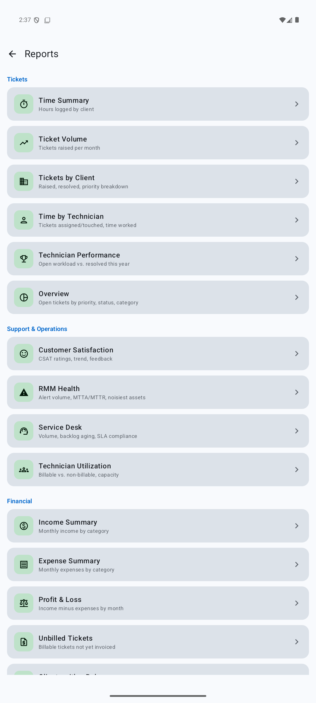 |

## 7. Credentials

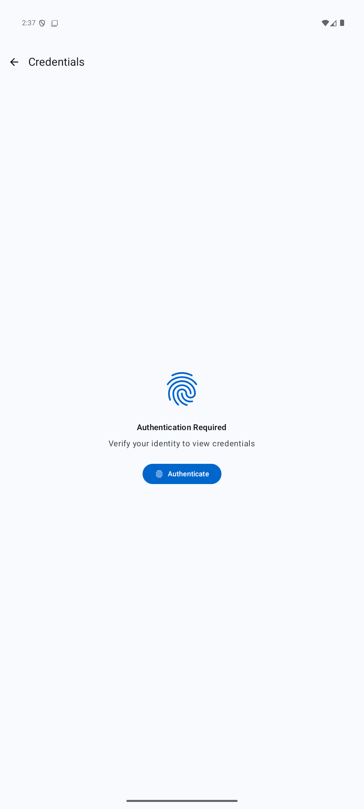

Credentials are protected: you must authenticate with your device biometrics/PIN every time you open them.

## 8. Quotes, Invoices, Expenses

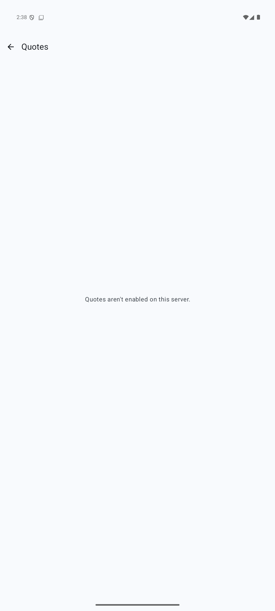

These appear in the menu on every server, but only work where the server has billing enabled. Otherwise you'll
see "… aren't enabled on this server."

## 9. Profile, security and appearance

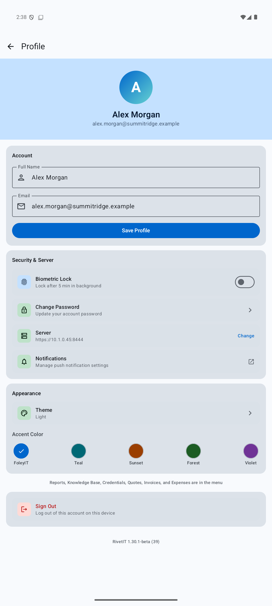

- Update your name/email, turn on **Biometric Lock** (re-locks after 5 minutes in the background),
  change your password, or change server.
- **Theme** (System/Light/Dark) and **Accent Color**.

### Dark mode

| Home | Tickets | Menu |
|---|---|---|
| 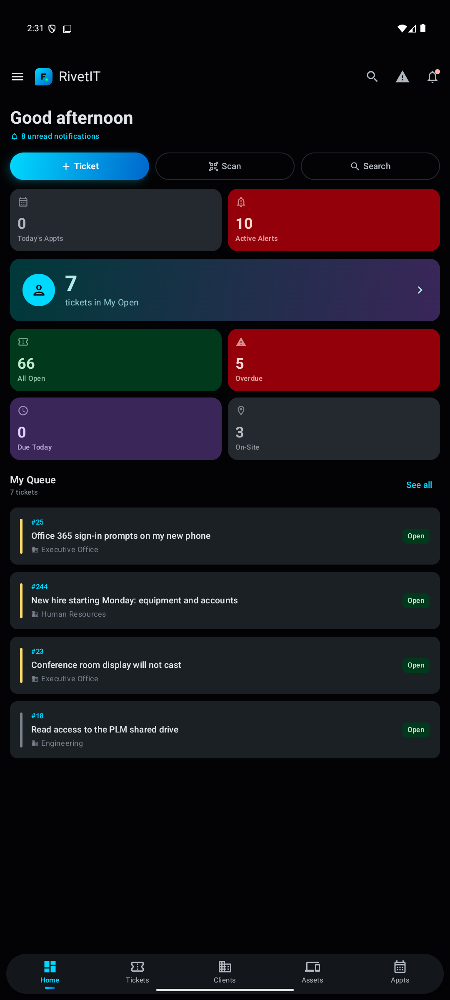 | 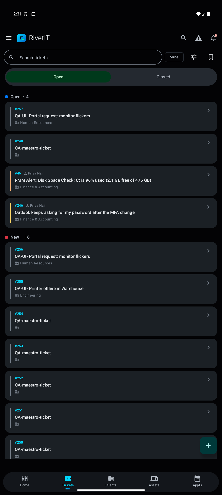 | 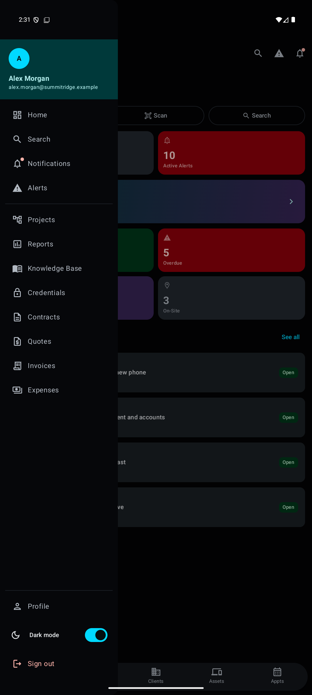 |

## Troubleshooting

- **"Network error"** — check the phone's connection and that the server address is reachable.
- **"Your session has expired"** — sign in again.
- **Spinner that never finishes** — pull back to Home and reopen; if it persists, check the server is up.
